# AlgoCompass

**Website: [26bma038-lang.github.io/algocompass](https://26bma038-lang.github.io/algocompass/)**

**Your competitive programming compass: one desktop app for Codeforces and LeetCode that finds your weak topics, tells you what to solve next, and keeps your streak alive. New to DSA? It teaches you step by step, with video lessons in English or Hindi, in the language you code in. Following Striver's A2Z or NeetCode 150? It ticks your progress for you.**

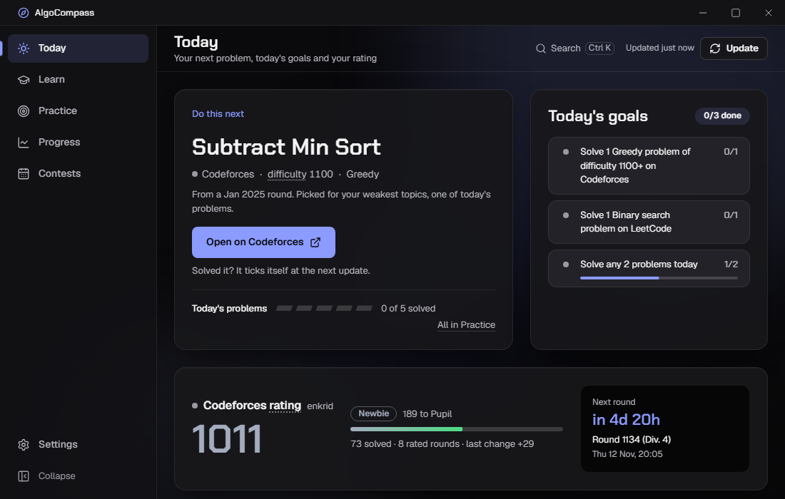

**[Download for Windows](https://github.com/26bma038-lang/algocompass/releases/latest)** · **[Website](https://26bma038-lang.github.io/algocompass/)** · Windows 10/11 · free · no account needed

## Why I built this

I practice on two sites. LeetCode is where I *learn* a topic (clean problems, good editorials), and Codeforces is where I *sharpen* it under contest pressure, which is where my rating lives. Neither site knows about the other, so there was no single answer to the questions I actually had every day:

- Which topics am I weak at, across **both** platforms?
- What should I solve **next**: something to learn on LeetCode, or something to sharpen on Codeforces?
- Am I staying consistent, or did I quietly skip three days?

AlgoCompass answers those in a two-second glance, from the tray, without logins or uploads. The Codeforces rating climb is the goal; LeetCode is the classroom.

## Two modes

On the first screen, answer **"New to DSA?"**. You can switch any time in Settings.

- **Yes, I'm new (Beginner mode):** you're on Step 1 of the **Beginner Path** in under a minute. No handles needed. Pick the video language (English or Hindi) and the language you code in (C++, Java, Python or JavaScript).
- **No, I already practise (Smart mode):** enter your Codeforces handle (and optionally your LeetCode username). Both are checked against the sites, then the first update takes about a minute.

| | |
|---|---|
| 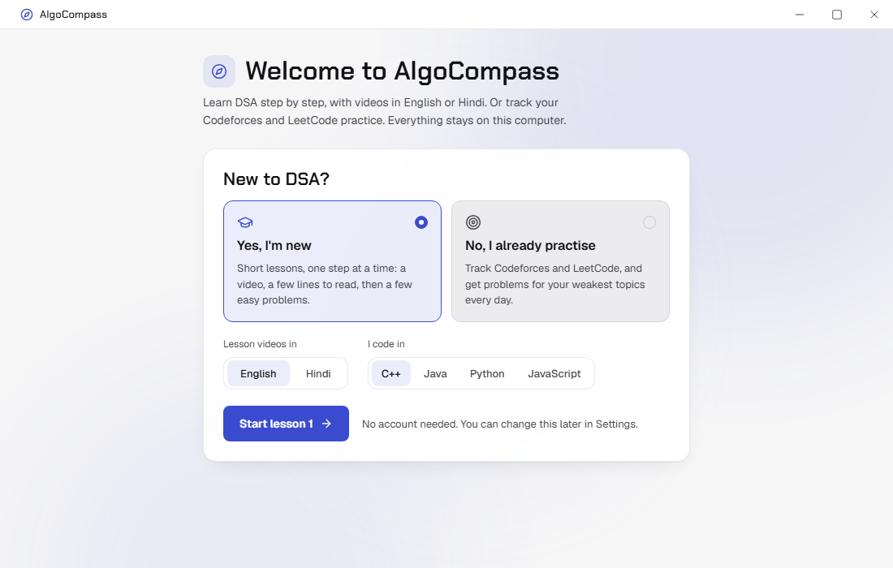 | 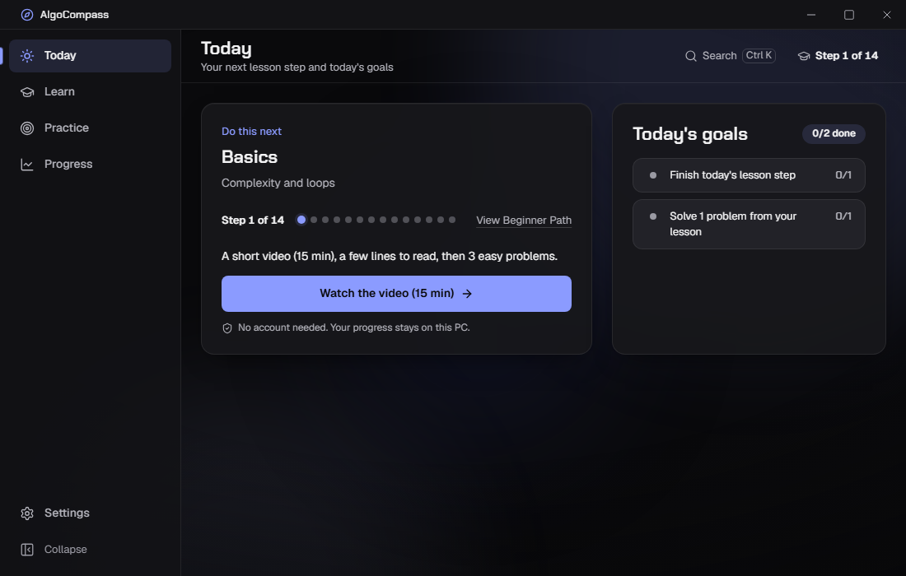 |

## The screens

Five screens with plain names, in this order in the sidebar (Ctrl+1 to Ctrl+5): **Today · Learn · Practice · Progress · Contests**, plus **Settings** (Ctrl+,). In Beginner mode, Contests joins the sidebar, marked "New", once you finish the Recursion step: that's when you're ready for your first contest.

### Today: what do I do today?
- **Smart mode:** three cards. **Do this next** is one problem to open right now (the first unsolved of today's problems, then your sheet's next one). **Today's goals** are three small goals that tick themselves when an update sees the accepted submission. The **rating card** shows your Codeforces rating in your real rank colour, the distance to the next rank, and the next round.
- **Beginner mode:** one **Do this next** card with the exact next lesson action ("Watch the video (15 min)", "Solve problem 2 of 3: Running Sum"), beside today's goals. Nothing else.

### Learn: every video in one place
- **Continue learning:** your current lesson, last video or playlist part, one click to resume.
- **Playlists (new in v1.6):** whole YouTube courses and topic series, every video in order, in English and Hindi: Striver's A2Z, Graph, DP and Binary Search series, NeetCode, William Fiset, Abdul Bari, Kunal Kushwaha, Pepcoding, CodeHelp, Aditya Verma, Apna College, Luv, Gate Smashers and more (111 playlists, about 4,700 videos, including JavaScript courses since v1.7). A playlist opens where you left off, says "Part 12 of 56", and ticks each part as you watch it.
- **Practice this (new in v1.6):** after every video, 3 to 5 must-do problems on its topic from the popular sheets, plus **Sharpen on Codeforces** with 2 problems in your rating window.
- **The Beginner Path:** 14 steps from loops and complexity through arrays, strings, hashing, two pointers, sliding window, stacks and queues, binary search, recursion, linked lists, trees, graphs and greedy, to dynamic programming.
- **The video library:** every single video, grouped by topic (your weakest first in Smart mode, by path step in Beginner mode), in English, Hindi or both, with search.
- **Your coding language:** every video says what it codes in (Concept, C++, Java, Python). The library and playlists show yours plus concept videos by default; "All languages" is one click.

| | |
|---|---|
| 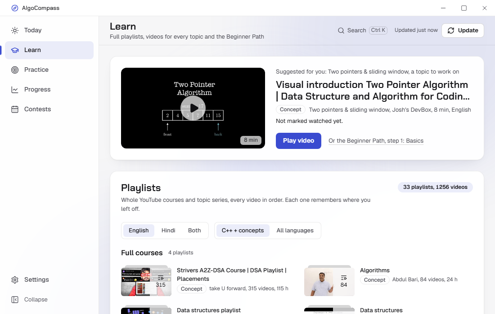 | 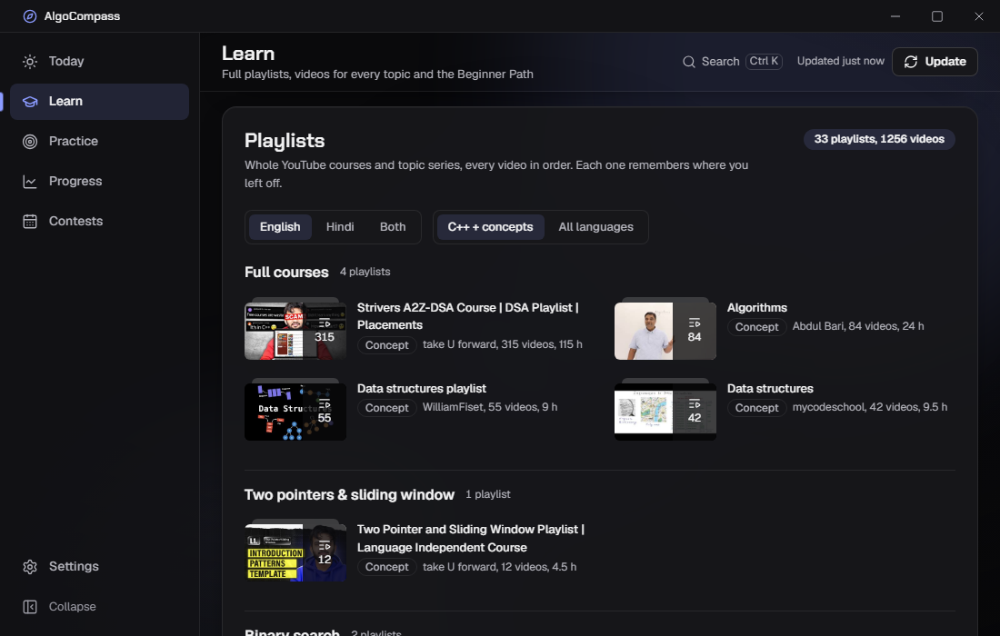 |
| 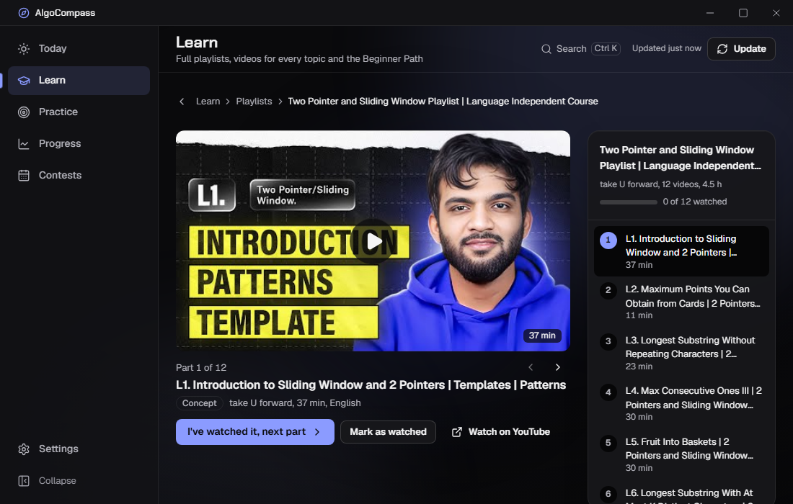 | 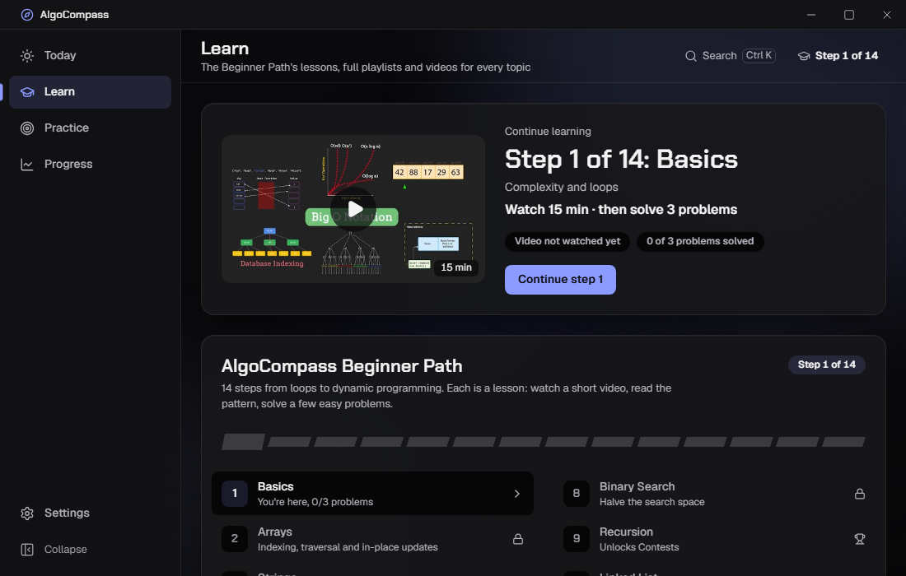 |

**A lesson** opens in focus mode: a big video that explains the idea, then **Read** (the pattern in five lines plus a code template in all four languages, yours first), **Code it in <your language>** (a verified walkthrough in your language, or an honest "none yet" with the closest one), and **Solve** (a few easy problems). One **Next** button walks you through it: I've watched the video → I've read it → Open problem 1 of 3 → I solved it → … → Next step. Watch the main video and solve the required problems to unlock the next step.

| | |
|---|---|
| 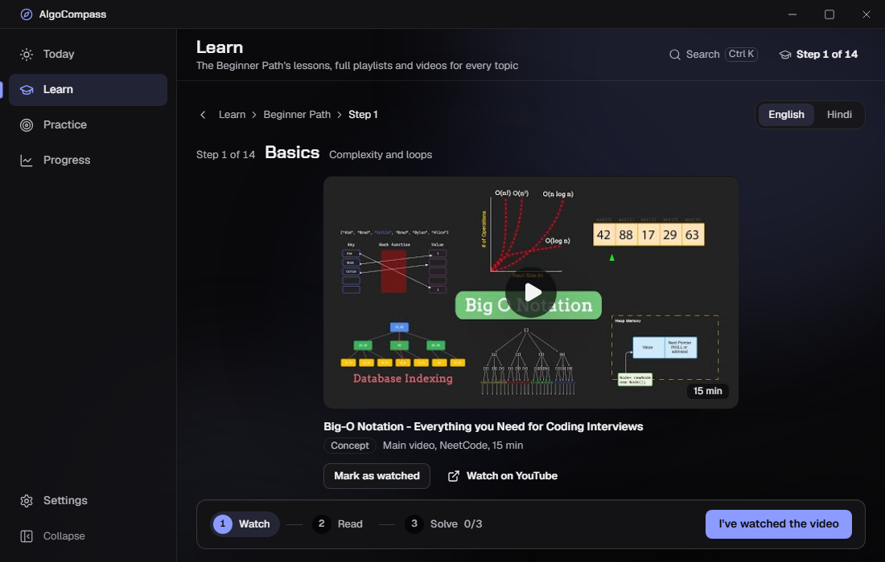 | 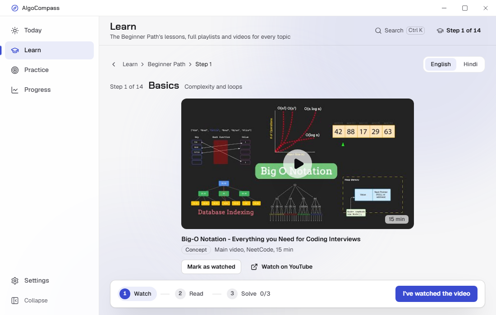 |

### Practice: what to solve
- **Today's problems (Smart mode):** 3 Codeforces problems for your weakest topics, rated just above your rating, and 2 LeetCode problems for the topic you're learning. The one to do now is marked "Recommended next". Each row's ⋯ menu has Skip, Too easy, Too hard (they move that topic's difficulty window) and I solved it. **Problems you tried** lists problems you attempted and never got accepted; **More by topic** is folded below.
- **Sheets:** follow **Striver's A2Z**, **Striver's SDE Sheet**, **NeetCode 150**, **Blind 75** or **Love Babbar's DSA 450**, in their original order and sections. Problems you solve on LeetCode or Codeforces tick themselves in every sheet that lists them; anything you solved elsewhere is one click. "I've already done some" catches you up if you're halfway through. **Next in this sheet** picks the next problem, and every section has "Learn this topic".
- **Problems from your lessons (Beginner mode):** the problems from the steps you've reached, with a card to follow a popular sheet when you want more.
- **Due for review (new in v1.7):** problems you solved come back after 7 and 30 days (3 if you needed help), at the top of Today's problems and in Do this next.
- **Notes and Stuck? (new in v1.7):** every problem row can hold a note (all of them in Progress → Your notes) and has **Stuck?**: its topics, a verified video on the topic, an easier problem on it, then the platform's editorial and solutions. Nothing is generated.

| | |
|---|---|
| 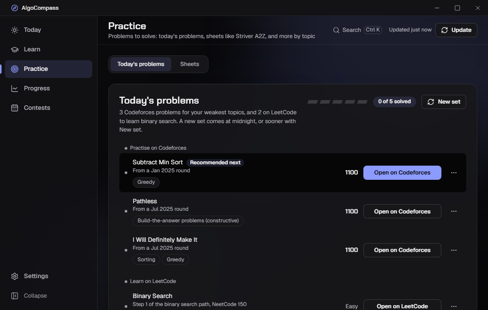 | 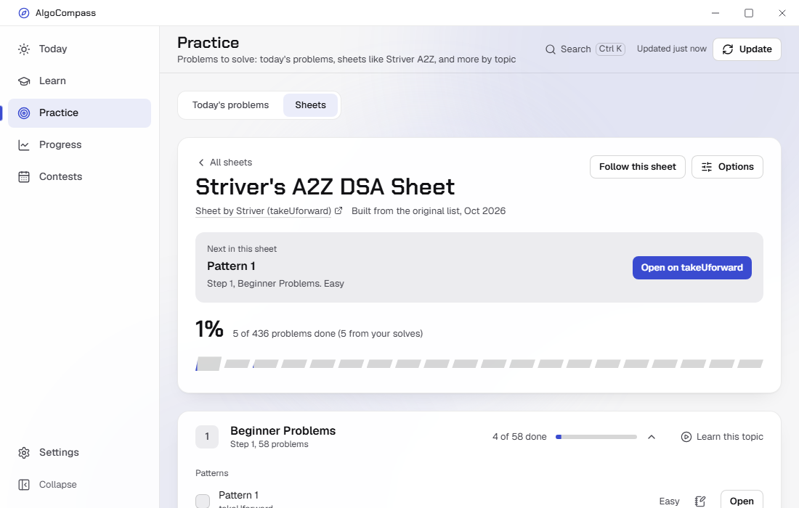 |

### Progress: how you're growing
Four tabs:
- **Overview:** your rating chart against the rank bands, a **rating goal** (new in v1.7: a target and a date, judged honestly against your best 90-day climb, with weekly targets from your own history), your level and XP, weekly goals as meters ("3 of 10, 7 to go"), the weekly review, your activity, LeetCode, badges and where you stand. "Continue today's practice" takes you back to doing.
- **Your notes** and **Friends** (new in v1.7): every note you wrote, searchable; and friends' Codeforces and LeetCode handles side by side with yours (rating, solved this week, streak), stored only on your computer.
- **Share my week** (new in v1.7): an image of your week (rating, solves, streak, top topic) in Light or Dark, saved where you choose. Nothing is uploaded.
- **Topics:** all 33 topics in plain words, weakest first, each with its strength (0–100) and why. **Show as map** draws them on a prerequisite graph. **Badges** has 31 of them across consistency, Codeforces, LeetCode, topics and fun. Rank promotions get a short "Aura Shift" moment; there's no confetti, ever.

Open any topic for its panel: where its strength comes from (Codeforces vs LeetCode), what you've solved and what's still open, recommended problems, curated resources, and two videos with **Watch lessons**.

| | |
|---|---|
| 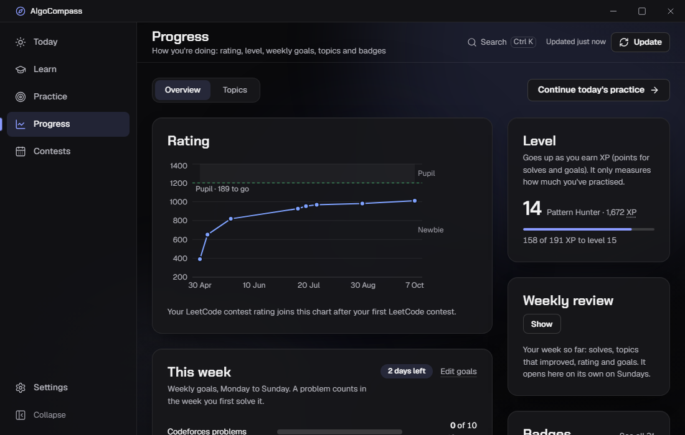 | 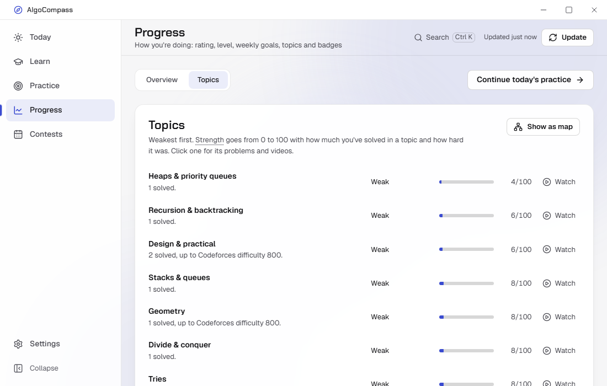 |
| 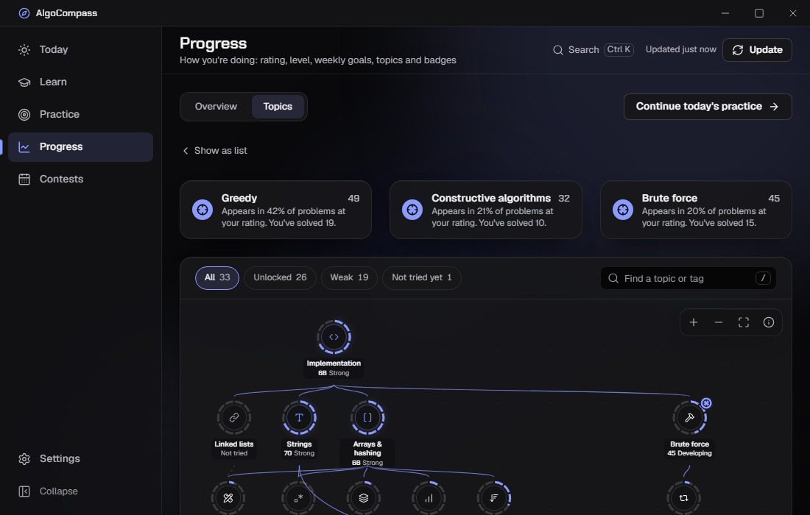 | 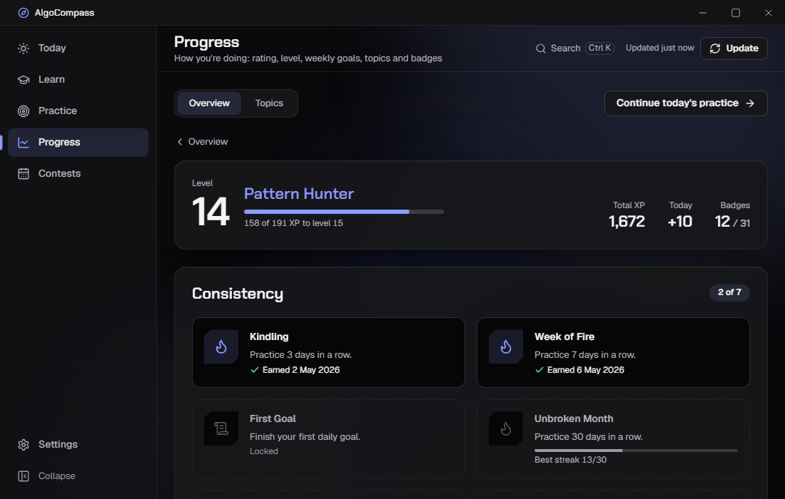 |

### Contests
Upcoming Codeforces rounds first, with LeetCode weekly and biweekly contests below. Each shows a countdown, local start time, duration and division, plus Register. "I'll attend" sets Windows reminders 1 hour and 10 minutes before. Past rounds show your rank, problems solved and rating change.
- **Contest review (new in v1.7):** one card per round you took part in: rating change, every problem by index, the topics of the ones you didn't solve, and **Fix next**, which joins the review queue.
- **Virtual contest (new in v1.7):** a past Div. 2, 3 or 4 round you've never touched, on a clock of its real length. Solves are your own Codeforces submissions inside the window; there are no made-up standings.

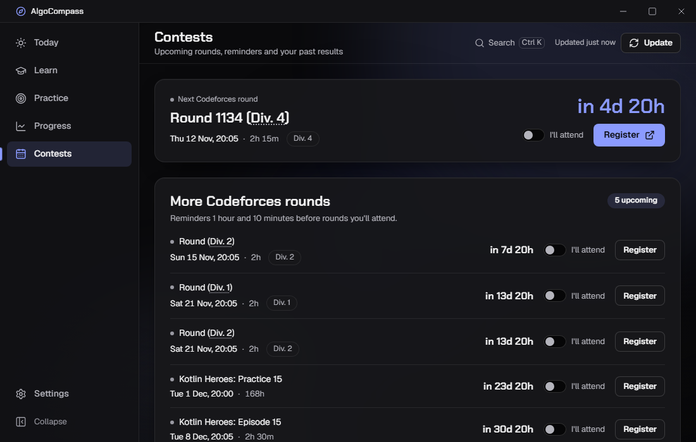

### Ctrl+K, everywhere
A search box for every screen, topic and action: jump to a topic, watch a topic's videos, update, open today's problems or the next contest. Ctrl+R updates and `?` lists every shortcut.

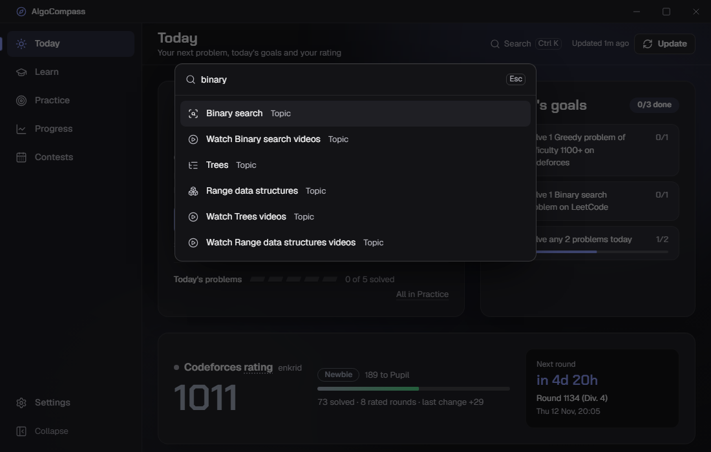

### Settings
Your handles, the mode (Beginner or Smart), **Language** (video language and "I code in"), the theme, weekly goals, a toggle per notification with the evening reminder time, and launch on Windows startup.

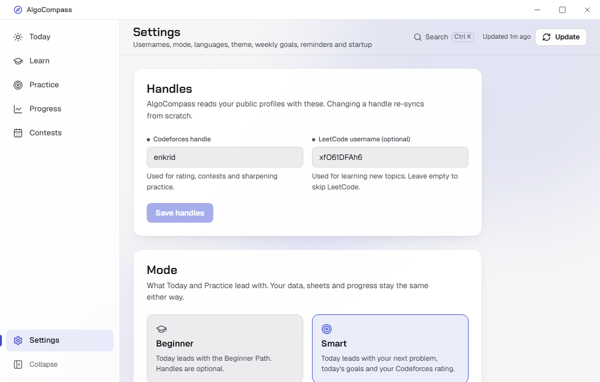

### Light and Dark
**System** (the default) follows your Windows light/dark setting and switches with it; you can also pin **Light** or **Dark**. Both are contrast-checked to WCAG AA, including the Codeforces rank colours, which stay on the things they belong to: your rating, your rank and your progress to the next rank.

| Light | Dark |
|---|---|
| 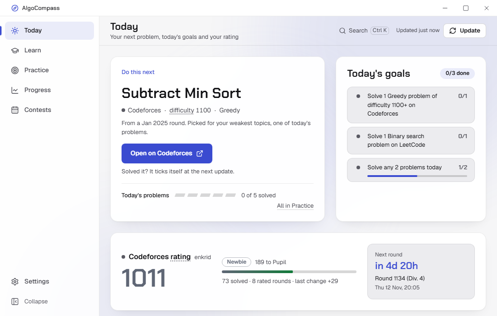 |  |

### On the desktop
- Lives in the system tray, with today's goals and links to each screen in the tray menu.
- Can launch on Windows startup, minimized.
- Windows notifications fire even while the window is hidden: contest reminders, an evening "streak at risk" nudge, goal completions, and (optional) a daily reminder naming your next problem.
- **Updates itself (from v1.7):** a quiet check once a day; a new version downloads in the background and asks you to restart. Every update is signed.
- Works offline from a local cache, and stale data is marked as stale.

### Sheet and video credits

The sheets belong to their creators. AlgoCompass only links to them and tracks your progress:
- **Striver's A2Z DSA Sheet** and **Striver's SDE Sheet** by Striver (Raj Vikramaditya), [takeUforward](https://takeuforward.org/prep-hub/strivers-a2z-dsa-sheet).
- **NeetCode 150** by [NeetCode](https://neetcode.io/practice).
- **Blind 75** by Yangshun Tay, from the [original Blind post](https://www.teamblind.com/post/New-Year-Gift---Curated-List-of-Top-75-LeetCode-Questions-to-Save-Your-Time-OaM1orEU) (2018).
- **DSA 450** by [Love Babbar](https://drive.google.com/file/d/1FMdN_OCfOI0iAeDlqswCiC2DZzD4nPsb/view).

Each sheet is built from its creator's own published list by `npm run gen:sheets`, and every sheet in the app shows "Sheet by …" with a link to the original. Videos and playlists belong to their channels: they're embedded from YouTube (privacy-enhanced player) and never downloaded or rehosted. Every video and playlist is checked against YouTube before a release.

## How it works

```
Codeforces API ─┐                       ┌─ topic engine ─┐
                ├─ adapters ─ SQLite ───┤                ├─ recommender ─ screens
LeetCode GQL ───┘   (normalize)  (cache)└─ goals / XP ───┘
```

1. **Adapters** (`src/adapters`) are the only code that talks to the platforms. They turn Codeforces and LeetCode responses into shared domain types, so nothing else knows either site's response format.
2. **Updates** store everything in a local **SQLite** database:
   - On start, every 2 hours, or on demand (the Update button, Ctrl+R).
   - Incremental: new submissions only, and the Codeforces problemset is cached for 24 hours.
   - Each platform fails independently.
3. **The topic engine** (`src/engine`, pure TypeScript, unit-tested) maps 38 Codeforces tags and 75 LeetCode tags onto 33 unified topics and scores each one 0–100:
   - **Codeforces solves** are weighted by the problem's rating relative to yours: 1× at your rating, ×2 for every +300, clamped to 0.2–4×.
   - **LeetCode solves** count Easy 1, Medium 2.5, Hard 5, at half weight (LeetCode is the classroom).
   - **Recency:** every solve decays with a **90-day half-life**, so a topic you haven't touched in months fades.
   - **Struggle:** a topic loses up to 30% for struggle (the share of your judged Codeforces submissions there that weren't accepted).
   - **Mastered** additionally needs a solve at or above your rating.
4. **The recommender** ranks topics by *how often they appear at your rating × weakness² × staleness*.
   - A topic is in **learn** mode (LeetCode, a curated Easy → Medium path) until you have 5 solves in it.
   - After that it's in **sharpen** mode: unsolved Codeforces problems rated between your rating and +200, recent rounds first.
5. **Screens** render it all (React, TanStack Query over the cache), and goals, XP and badges are derived from the same history.

**About LeetCode:** LeetCode has no public API, so AlgoCompass uses its **unofficial GraphQL endpoint** (the same one leetcode.com uses). It's isolated behind a single adapter that validates every field and fails soft. If LeetCode changes or blocks it, LeetCode data goes stale and everything else keeps working. LeetCode also only exposes your 20 most recent accepted solves, so older ones can be marked solved by hand.

## Download and install

1. Download the `AlgoCompass_…_x64-setup.exe` installer (or the `.msi`) from the **[latest release](https://github.com/26bma038-lang/algocompass/releases/latest)**.
2. Run it. The app isn't code-signed, so Windows SmartScreen will warn: click **More info → Run anyway**.
3. Answer "New to DSA?" on the welcome screen.

From v1.7.0 on, the app updates itself. Versions before 1.7.0 need this one manual install.

Requires Windows 10 or 11 with the WebView2 runtime. It's already on Windows 11, and the installer fetches it on Windows 10 if needed.

## Build from source

**Prerequisites**
- [Node.js](https://nodejs.org/) 20 or newer, with npm
- [Rust](https://rustup.rs/) (stable, MSVC toolchain)
- [Visual Studio Build Tools](https://visualstudio.microsoft.com/visual-cpp-build-tools/) with **Desktop development with C++** and a **Windows 11 SDK**

```powershell
git clone https://github.com/26bma038-lang/algocompass.git
cd algocompass
npm install
npm run tauri dev      # run the desktop app with hot reload
npm run tauri build    # installers in src-tauri/target/release/bundle/{nsis,msi}
```

Use PowerShell (or cmd), not Git Bash, for the Tauri and Cargo commands. Git Bash's `link` shadows the MSVC linker.

Releasing, adding videos and playlists, fixing a broken LeetCode API, and where user data lives: see **[MAINTAINING.md](MAINTAINING.md)**.

`npm run dev` also serves the UI in a plain browser. It uses an in-memory SQLite (sql.js) there and proxies LeetCode through Vite, which is handy for UI work.

### Tests and data scripts

```powershell
npm test               # migrations line endings, type-check + unit tests (Vitest)
$env:CF_HANDLE="tourist"; $env:LC_HANDLE="<username>"; npm run test:live   # a full update against the real APIs
npm run check:links    # verify every link: articles, sheet and path problems, every video and playlist
npm run gen:sheets     # rebuild src/data/sheets/*.json from the sheets' original sources
npm run fill:media     # refill video titles, channels and lengths (and path problems) from the platforms
npm run tag:videos     # tag every video with what it codes in (src/data/code-langs.json)
npm run fill:playlists # read every playlist's videos, in order, from YouTube (no API key)
```

`check:links` checks every LeetCode slug with LeetCode's GraphQL and every Codeforces id with `problemset.problems`. Every video and playlist must pass YouTube oEmbed with its exact title and channel and carry the right coding-language tag; a playlist whose video count changed on YouTube is a warning. `--deep` also opens every takeUforward practice link.

The unit tests cover the adapters (with stubbed fetch), updates against a real SQLite schema, and all of the engine: strength scoring, the recommender, goals, XP and levels, badges, reminders, contests, sheets, the Beginner Path, playlists and search ranking. The lesson code templates are compiled where a compiler is installed.

## Tech stack

- **Shell:** [Tauri 2](https://tauri.app/) (Rust) with a frameless window, a system tray, and a reminder scheduler in Rust.
- **UI:** React 18, Vite, TypeScript (strict), Tailwind CSS v4, shadcn/ui (Radix), Framer Motion, Recharts, React Flow (@xyflow/react), cmdk.
- **State:** Zustand for app state, TanStack Query for the data cache.
- **Tauri plugins:** sql (SQLite), http, store, notification, autostart, opener.
- **Data sources:** the official Codeforces API and LeetCode's unofficial GraphQL endpoint.

## Project structure

```
src/
  adapters/      Codeforces + LeetCode clients (the only code that touches the network)
  data/          SQLite access, updates, settings, TanStack Query hooks, and the bundled data:
    sheets/      The five sheets (generated from the original sources, verified)
    path/        The Beginner Path's 14 lessons and their code templates
    playlists.json  Full YouTube playlists (filled from YouTube, verified)
  engine/        Pure analysis: topics, strength, recommender, goals, XP, badges, reminders,
                 sheets, the Beginner Path, Learn, playlists and coding languages
  features/      One folder per screen (home, learn, practice, sheets, progress, topic, contests,
                 settings, onboarding…)
  components/    Shell (title bar, sidebar, top bar, search) and shadcn/ui primitives
src-tauri/
  src/lib.rs     Window, tray, plugins, reminder scheduler
  migrations/    SQLite schema migrations
  capabilities/  Permission scope (only codeforces.com/api and leetcode.com/graphql)
scripts/         Data and check scripts (sheets, videos, playlists, links, contrast)
website/         The landing page (static HTML/CSS/JS, deployed to GitHub Pages)
docs/screenshots README images
DESIGN.md        The visual system ("The Rank Aura")
```

## Roadmap

- **AI coach:** a weekly plan in plain words from your topic report and contest results, plus explanations of *why* a submission got WA.
- **Rating predictor:** expected rating change during a live round, and a projection toward your next rank.
- **Mobile companion:** a read-only phone view of the streak, today's goals and the next round.

## Privacy

Everything stays on your computer.
- Your data lives in a local SQLite database and settings file in `%APPDATA%\com.algocompass.app`.
- The app only calls `codeforces.com/api` and `leetcode.com/graphql`, to read your **public** profiles (yours and any friends you add). The Tauri permission scope enforces that.
- Once a day it downloads `latest.json` from this repository's latest GitHub release to see whether there's a newer version. Nothing about you is sent.
- **Share my week** saves an image to a place you pick; it's never uploaded.
- Videos come from YouTube's privacy-enhanced player (`youtube-nocookie.com`). Nothing loads from YouTube until you press play, apart from thumbnails (`i.ytimg.com`). The content security policy allows only those two YouTube hosts.
- Sheet ticks, notes, watched videos and where you left off in each playlist stay on your computer.
- No accounts, no analytics, no telemetry, and nothing is uploaded anywhere.

## License

Copyright (c) 2026 Sahil. All rights reserved. You may view the source code and download and use the released app for personal, non-commercial purposes. No part of the source code may be copied, modified, distributed, or used in other projects without prior written permission. See [LICENSE](LICENSE). Contributions: see [CONTRIBUTING.md](CONTRIBUTING.md).
