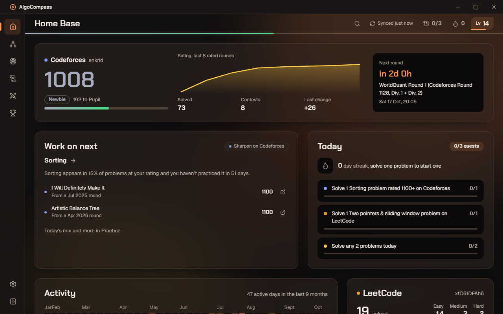
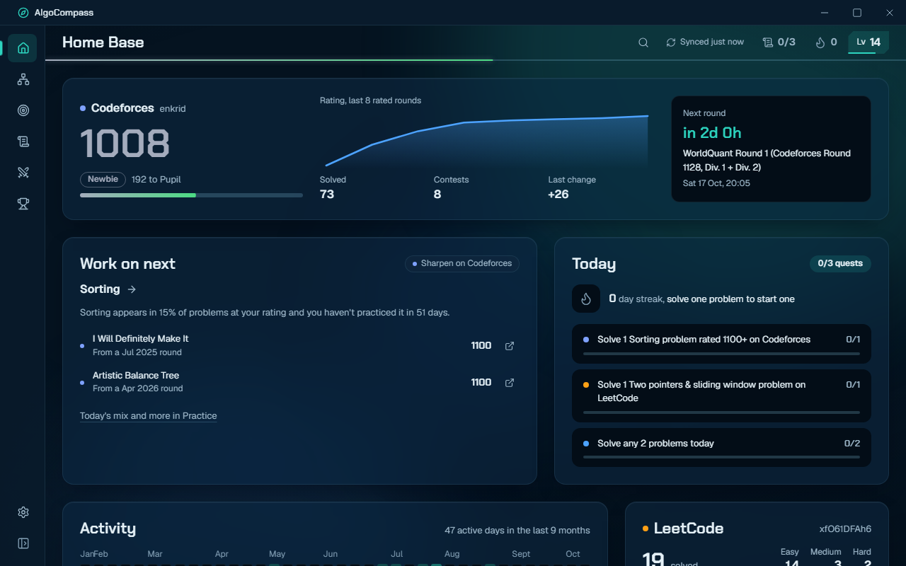
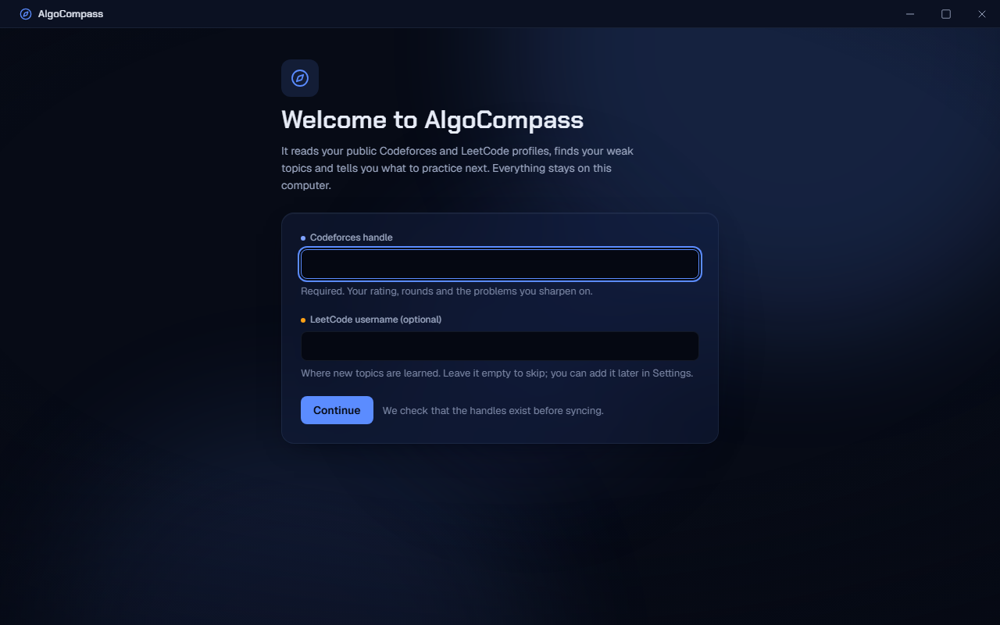

# AlgoCompass

**Your competitive programming compass: one desktop app for Codeforces and LeetCode that finds your weak topics, tells you what to solve next, and keeps your streak alive.**


**[Download for Windows](https://github.com/26bma038-lang/algocompass/releases/latest)** · Windows 10/11 · free · no account needed

## Why I built this

I practice on two sites. LeetCode is where I *learn* a topic (clean problems, good editorials), and Codeforces is where I *sharpen* it under contest pressure, which is where my rating lives. Neither site knows about the other, so there was no single answer to the questions I actually had every day:

- Which topics am I weak at, across **both** platforms?
- What should I solve **next**: something to learn on LeetCode, or something to sharpen on Codeforces?
- Am I staying consistent, or did I quietly skip three days?

AlgoCompass answers those in a two-second glance, from the tray, without logins or uploads. The Codeforces rating climb is the goal; LeetCode is the classroom.

## Features

### Home Base: the daily check-in
A bento grid that answers "am I on track today?" at a glance:
- **The hero:** your Codeforces rating in your real rank colour, a rating sparkline, progress to the next rank, and a countdown to the next round.
- **Today's two cards:** the topic to work on next (with the two problems to start with), and your streak with today's quests.
- **Below:** your activity heatmap, LeetCode, the later contests, and where you stand.

The hero and both cards fit in the window at 1100×700.

### Skill Tree
33 topics on a prerequisite graph (built with React Flow). Each node has a mastery ring scored 0–100 from your own solves. Topics unlock as their prerequisites reach Developing. The three most urgent ones lead the screen as "Work on next" tiles, each with its reason.


### Topic Detail
Open any topic to see its strength and where it comes from (Codeforces vs LeetCode), hardest solve, struggle rate, what you've solved and what's still open. It also lists recommended problems (LeetCode to learn, Codeforces to sharpen) and curated resources (CP-Algorithms, USACO Guide, NeetCode, CSES and more).


### Practice: the recommender
- **Mix of the Day:** 3 Codeforces problems, one for each of your weakest topics, rated just above your rating. Plus 2 LeetCode problems for the next topic you're learning.
- **Upsolve:** problems you tried and never got accepted, and problems you didn't solve in a recent contest.
- **By topic:** every weak topic with its own problems.

Feedback (Skip / Too easy / Too hard) moves a topic's difficulty window up or down.


### Quests
Three daily quests drawn from your mix. They check themselves off when a sync sees the accepted submission. There are also weekly goals with progress rings, XP and levels, and a weekly review every Sunday.


### Contests
Upcoming Codeforces rounds come first, with LeetCode weekly and biweekly contests below them. Each shows a countdown, local start time, duration and division, plus a Register button. Mark "I'll attend" to get Windows reminders 1 hour and 10 minutes before. Past rounds show your rank, problems solved and rating change, and a full rating chart shows every rated round against the rank bands.


### Achievements
Your level and title (Novice Coder → Pattern Hunter → Algorithm Smith…), computed from your whole history, plus 31 achievements across Consistency, Codeforces, LeetCode, Topics and Fun. Locked ones show your progress, e.g. "Best streak 13/30". Rank promotions get a short "Aura Shift" moment; there's no confetti, ever.


### Ctrl+K, everywhere
A command palette to jump to any screen or topic, sync, or open today's mix or the next contest, all from the keyboard. Ctrl+R syncs and `?` lists every shortcut.


### Settings
- Your handles and the theme.
- Weekly goals: Codeforces problems, LeetCode problems and contests per week.
- A toggle for each notification, with the evening reminder time.
- Launch on Windows startup.


### Themes
Three vibrant themes: **Neon Arcade** (electric violet and cyan, the default), **Ember** (orange and gold on charcoal) and **Ocean** (teal and bright blue on navy). Every theme is contrast-checked for readability. Your Codeforces rank colour stays on the things it belongs to: your rating, your rank and your progress to the next rank.

| Ember | Ocean |
|---|---|
|  |  |

### Desktop
- Lives in the system tray, with a tray menu showing today's quest progress.
- Can launch on Windows startup, minimized.
- Windows notifications fire even while the window is hidden: contest reminders, an evening "streak at risk" nudge, and quest completions.
- Works offline from a local cache, and stale data is marked as stale.

### First launch
Enter your Codeforces handle (required) and LeetCode username (optional). Both are checked against the sites before the first sync starts, which takes about a minute.



## How it works

```
Codeforces API ─┐                       ┌─ topic engine ─┐
                ├─ adapters ─ SQLite ───┤                ├─ recommender ─ screens
LeetCode GQL ───┘   (normalize)  (cache)└─ quests / XP ──┘
```

1. **Adapters** (`src/adapters`) are the only code that talks to the platforms. They turn Codeforces and LeetCode responses into shared domain types, so nothing else knows either site's response format.
2. **Sync** stores everything in a local **SQLite** database:
   - It runs on start, every 2 hours, or on demand.
   - It's incremental: new submissions only, and the Codeforces problemset is cached for 24 hours.
   - Each platform fails independently.
3. **The topic engine** (`src/engine`, pure TypeScript, unit-tested) maps 38 Codeforces tags and 75 LeetCode tags onto 33 unified topics and scores each one 0–100:
   - **Codeforces solves** are weighted by the problem's rating relative to yours: 1× at your rating, ×2 for every +300, clamped to 0.2–4×.
   - **LeetCode solves** count Easy 1, Medium 2.5, Hard 5, at half weight (LeetCode is the classroom).
   - **Recency:** every solve decays with a **90-day half-life**, so a topic you haven't touched in months fades.
   - **Struggle:** a topic loses up to 30% for struggle (the share of your judged Codeforces submissions there that weren't accepted).
   - **Mastered** additionally needs a solve at or above your rating.
4. **The recommender** ranks topics by *how often they appear at your rating × weakness² × staleness*.
   - A topic stays in **Learn** mode (LeetCode, a curated Easy → Medium path) until you have 5 solves in it.
   - After that it's in **Sharpen** mode: unsolved Codeforces problems rated between your rating and +200, recent rounds first.
5. **Screens** render it all (React, TanStack Query over the cache), and quests, XP and achievements are derived from the same history.

**About LeetCode:** LeetCode has no public API, so AlgoCompass uses its **unofficial GraphQL endpoint** (the same one leetcode.com uses). It's isolated behind a single adapter that validates every field and fails soft. If LeetCode changes or blocks it, LeetCode data goes stale and everything else keeps working. LeetCode also only exposes your 20 most recent accepted solves, so older ones can be marked solved by hand.

## Download and install

1. Download the `AlgoCompass_…_x64-setup.exe` installer (or the `.msi`) from the **[latest release](https://github.com/26bma038-lang/algocompass/releases/latest)**.
2. Run it. The app isn't code-signed, so Windows SmartScreen will warn: click **More info → Run anyway**.
3. Enter your Codeforces handle (and optionally your LeetCode username) on the welcome screen.

Requires Windows 10 or 11 with the WebView2 runtime. It's already on Windows 11, and the installer fetches it on Windows 10 if needed.

## Build from source

**Prerequisites**
- [Node.js](https://nodejs.org/) 20 or newer, with npm
- [Rust](https://rustup.rs/) (stable, MSVC toolchain)
- [Visual Studio Build Tools](https://visualstudio.microsoft.com/visual-cpp-build-tools/) with **Desktop development with C++** and a **Windows 11 SDK**

```powershell
git clone https://github.com/26bma038-lang/algocompass.git
cd algocompass
npm install
npm run tauri dev      # run the desktop app with hot reload
npm run tauri build    # installers in src-tauri/target/release/bundle/{nsis,msi}
```

Use PowerShell (or cmd), not Git Bash, for the Tauri and Cargo commands. Git Bash's `link` shadows the MSVC linker.

`npm run dev` also serves the UI in a plain browser. It uses an in-memory SQLite (sql.js) there and proxies LeetCode through Vite, which is handy for UI work.

### Running tests

```powershell
npm test               # type-check + unit tests (Vitest)
$env:CF_HANDLE="tourist"; $env:LC_HANDLE="<username>"; npm run test:live   # full sync against the real APIs
npm run check:links    # verify every curated resource and LeetCode problem link
```

The unit tests cover the adapters (with stubbed fetch), sync against a real SQLite schema, and all of the engine: strength scoring, the recommender, quests, XP and levels, achievements, reminder scheduling, contests and the command palette ranking.

## Tech stack

- **Shell:** [Tauri 2](https://tauri.app/) (Rust) with a frameless window, a system tray, and a reminder scheduler in Rust.
- **UI:** React 18, Vite, TypeScript (strict), Tailwind CSS v4, shadcn/ui (Radix), Framer Motion, Recharts, React Flow (@xyflow/react), cmdk.
- **State:** Zustand for app state, TanStack Query for the data cache.
- **Tauri plugins:** sql (SQLite), http, store, notification, autostart, opener.
- **Data sources:** the official Codeforces API and LeetCode's unofficial GraphQL endpoint.

## Project structure

```
src/
  adapters/      Codeforces + LeetCode clients (the only code that touches the network)
  data/          SQLite schema access, sync, settings, TanStack Query hooks
  engine/        Pure analysis: topics, strength, recommender, quests, XP, achievements, reminders
  features/      One folder per screen (home, skill-tree, topic, practice, quests, contests,
                 achievements, settings, onboarding)
  components/    Shell (title bar, sidebar, top bar, palette) and shadcn/ui primitives
src-tauri/
  src/lib.rs     Window, tray, plugins, reminder scheduler
  migrations/    SQLite schema migrations
  capabilities/  Permission scope (only codeforces.com/api and leetcode.com/graphql)
docs/screenshots README images
DESIGN.md        The visual system ("The Rank Aura")
```

## Roadmap

- **AI coach:** a weekly plan in plain words from your topic report and contest results, plus explanations of *why* a submission got WA.
- **Revision queue:** spaced repetition for problems you struggled with, resurfacing at 3, 7 and 21 days.
- **Friends comparison:** add a few Codeforces handles and compare ratings, topic strengths and weekly solves.
- **Problem notes:** the key idea and the mistake for each problem, searchable from the palette.
- **Rating predictor:** expected rating change during a live round, and a projection toward your next rank.
- **Mobile companion:** a read-only phone view of the streak, today's quests and the next round.

## Privacy

Everything stays on your computer.
- Your data lives in a local SQLite database and settings file in `%APPDATA%\com.algocompass.app`.
- The app only calls `codeforces.com/api` and `leetcode.com/graphql`, to read your **public** profiles. The Tauri permission scope enforces that.
- No accounts, no analytics, no telemetry, and nothing is uploaded anywhere.

## License

Copyright (c) 2026 Sahil. All rights reserved. You may view the source code and download and use the released app for personal, non-commercial purposes. No part of the source code may be copied, modified, distributed, or used in other projects without prior written permission. See [LICENSE](LICENSE). Contributions: see [CONTRIBUTING.md](CONTRIBUTING.md).
