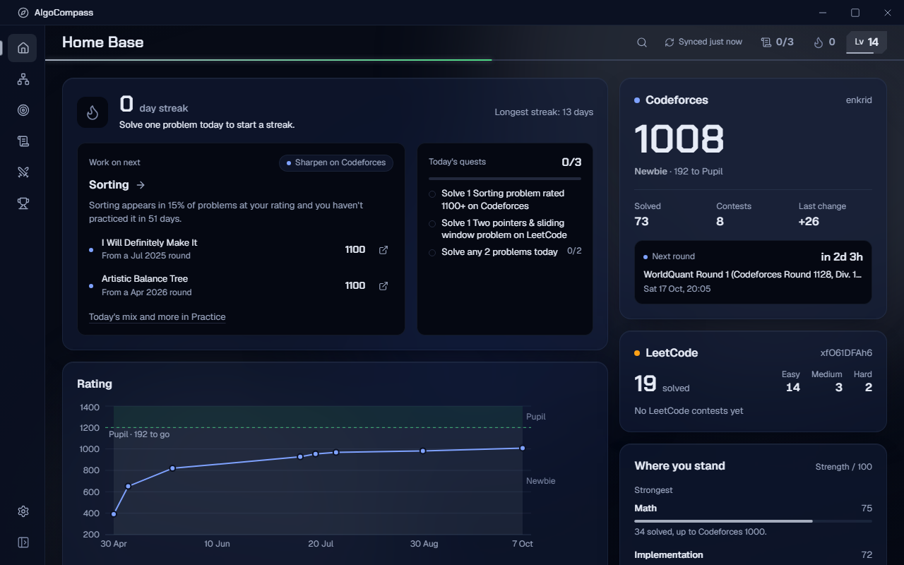
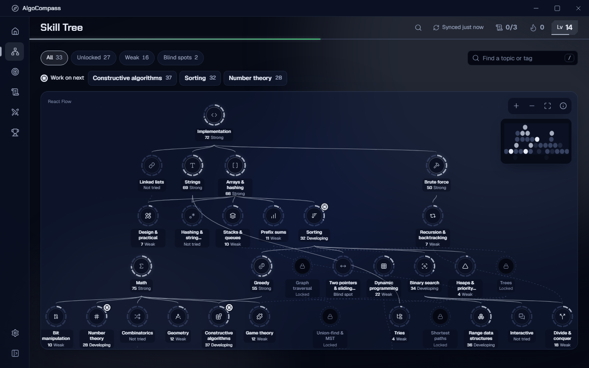
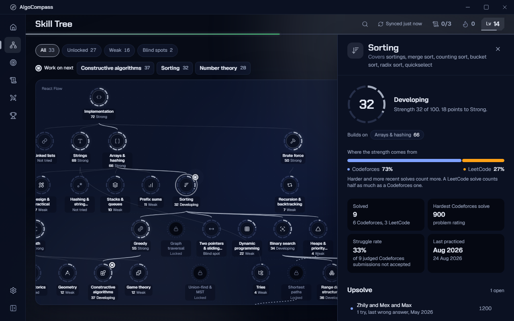
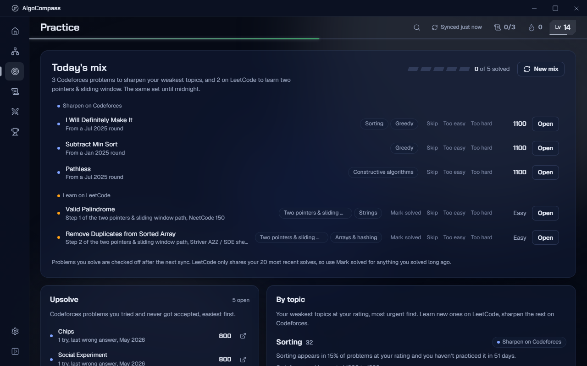
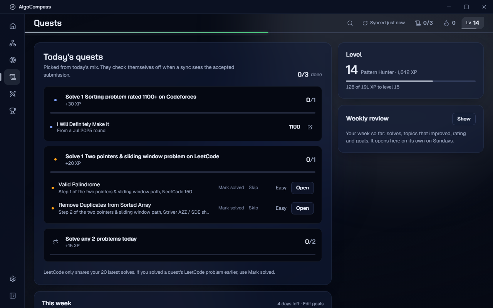
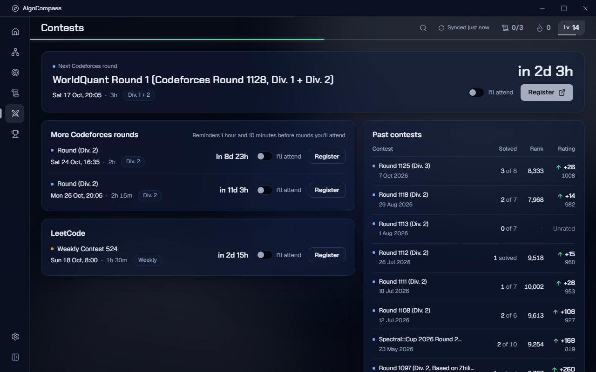
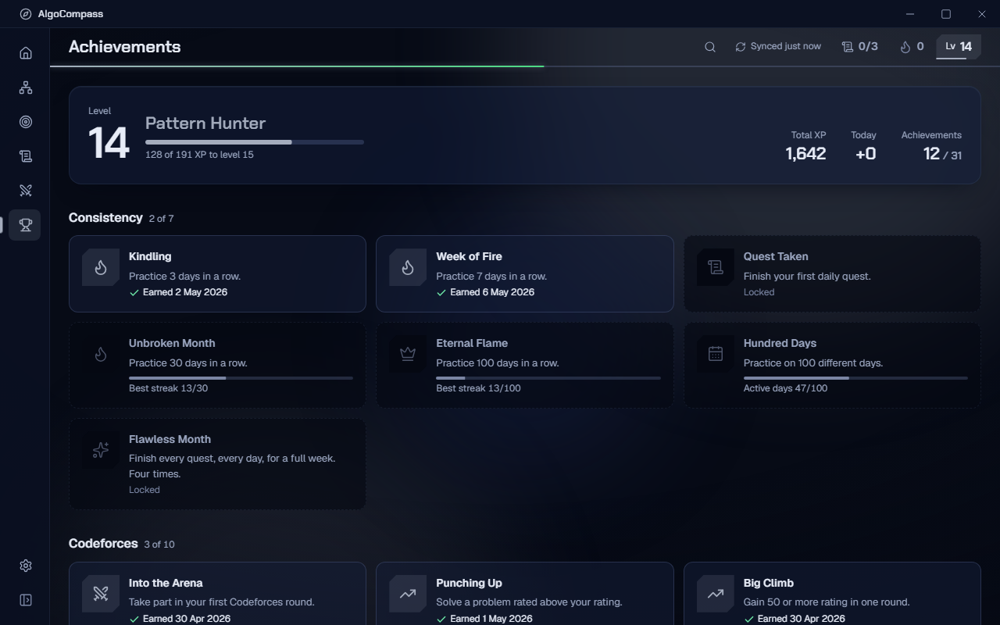

# AlgoCompass

A Windows desktop compass for competitive programmers. AlgoCompass tracks your **Codeforces** and **LeetCode** practice, works out which topics are strong and which are weak, tells you what to study next, and keeps you consistent with daily quests, streaks and reminders.

**The Codeforces rating climb is the goal.** New topics are learned on LeetCode and sharpened on Codeforces until they're strong. The app reads your public profiles, so there is no account to make and nothing to log in to.



## What it does

- **Home Base:** the daily check-in. Your rating, streak, today's quests, what to work on next, and the next Codeforces round, all in one screen.
- **Skill Tree:** 33 topics on a prerequisite graph, each with a mastery ring. Scores come from your own solves, weighted by difficulty and recency.
- **Topic Detail:** one topic's strength, history, and recommended problems: LeetCode to learn it, Codeforces to sharpen it. Curated resources come with each topic.
- **Practice:** a fresh Mix of the Day (3 Codeforces + 2 LeetCode), an Upsolve list, and problems for each weak topic.
- **Quests:** three daily quests from your mix, weekly goals with progress rings, and a weekly review.
- **Contests:** upcoming Codeforces rounds first and LeetCode contests below them, with countdowns, "I'll attend" reminders and your past results. Problems you didn't solve in a round go to Upsolve automatically.
- **Achievements:** a level and title earned from your whole history, plus 31 achievements.
- **Desktop:** runs from the tray, launches at startup if you want, sends Windows notifications 1 hour and 10 minutes before rounds and when your streak is at risk. Ctrl+K opens a command palette; press `?` for every shortcut.

It works offline from a local SQLite cache and marks stale data as stale. It never invents numbers.

| | |
|---|---|
|  |  |
|  |  |
|  |  |

## Install

1. Download `AlgoCompass_1.0.0_x64-setup.exe` (or the `.msi`) from the release.
2. Run it. Windows SmartScreen may warn about an unsigned app: choose **More info → Run anyway**.
3. Open **Settings** and enter your Codeforces handle and LeetCode username. The first sync takes about a minute (it caches the Codeforces problemset).

Requires Windows 10 or 11 with the WebView2 runtime (already installed on Windows 11; the installer fetches it on Windows 10 if needed).

## Build from source

Prerequisites:
- Node.js 20+ and npm
- Rust (stable, MSVC toolchain)
- Visual Studio Build Tools with **Desktop development with C++** and a **Windows 11 SDK**

```powershell
npm install
npm run tauri dev      # run the desktop app with hot reload
npm test               # type-check + unit tests (Vitest)
npm run tauri build    # installers in src-tauri/target/release/bundle/{nsis,msi}
```

Run Cargo and Tauri from PowerShell, not Git Bash. Git Bash's `link` shadows the MSVC linker.

`npm run dev` serves the UI in a plain browser too. It then uses an in-memory SQLite (sql.js) and proxies LeetCode through Vite. That mode is handy for UI work; the desktop build uses tauri-plugin-sql.

Other scripts:
- `npm run test:live`: a full sync against the real APIs.
- `npm run check:links`: verifies every curated resource and LeetCode problem link.
- `npm run gen:lc-lists`: regenerates the curated LeetCode lists from `scripts/lc-lists.txt`.

## Tech stack

- **Shell:** Tauri 2 (Rust) with a frameless window, tray, and a reminder scheduler in Rust.
- **UI:** React 18, Vite, TypeScript (strict), Tailwind v4, shadcn/ui (Radix), Framer Motion, Recharts, @xyflow/react, cmdk.
- **State:** Zustand for app state and TanStack Query for cached data.
- **Data:** tauri-plugin-sql (SQLite), tauri-plugin-http, tauri-plugin-store, tauri-plugin-notification, tauri-plugin-autostart.
- **Sources:** the official Codeforces API, and LeetCode's unofficial GraphQL API. LeetCode is isolated behind an adapter that fails soft, so a LeetCode outage only affects LeetCode data.

The code is layered: `src/adapters` talks to the platforms; `src/data` handles the SQLite cache, sync and query hooks; `src/engine` holds the pure analysis logic (strength, recommender, quests, XP, achievements), all unit-tested; and `src/features` has one folder per screen. The visual system ("The Rank Aura", where the accent color is your real Codeforces rank color) is specified in [DESIGN.md](DESIGN.md).

## Privacy

Everything stays on your machine. AlgoCompass only calls `codeforces.com/api` and `leetcode.com/graphql`, and the Tauri capability scope enforces that.
